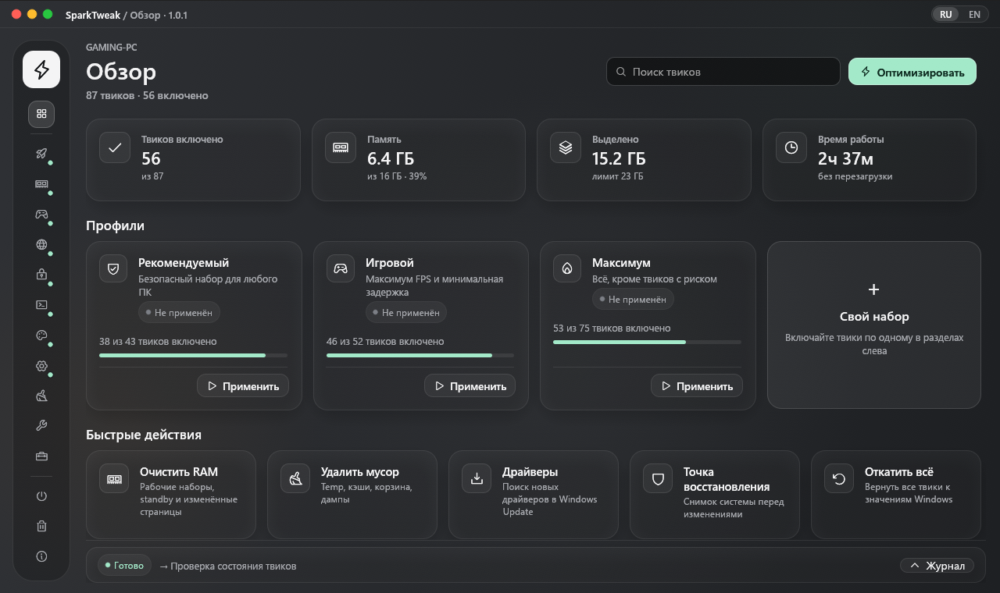
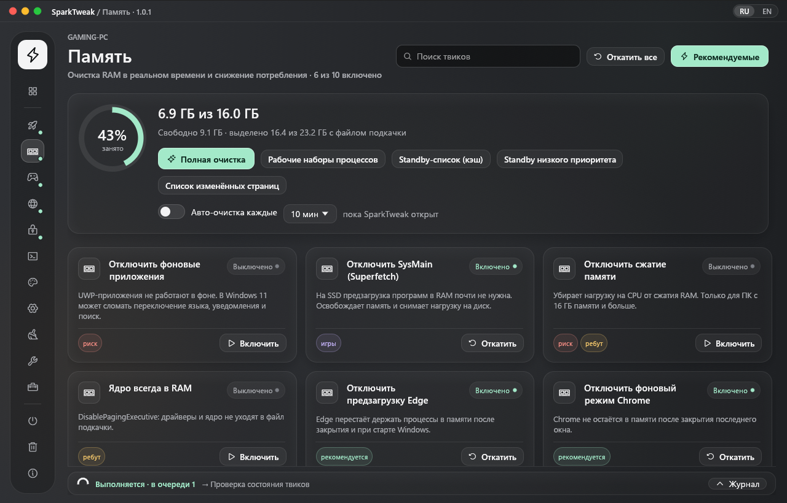
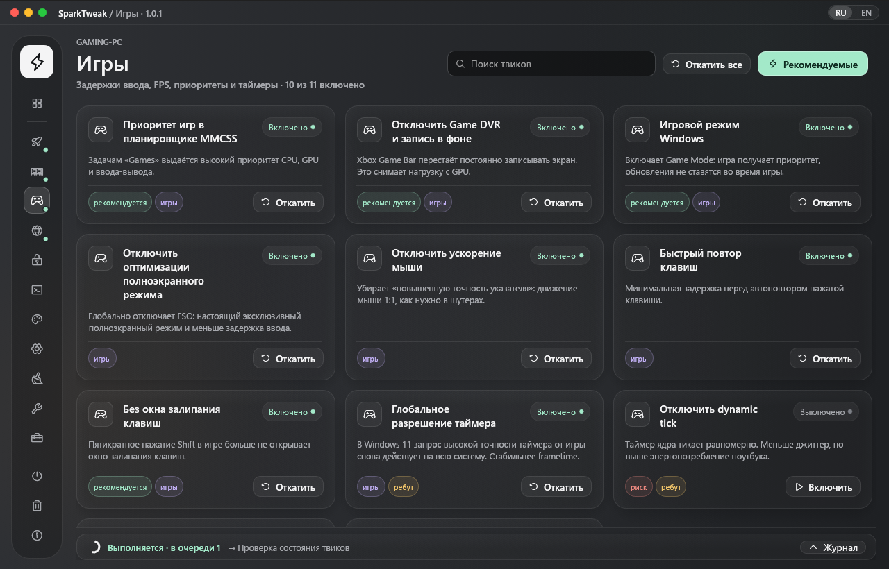
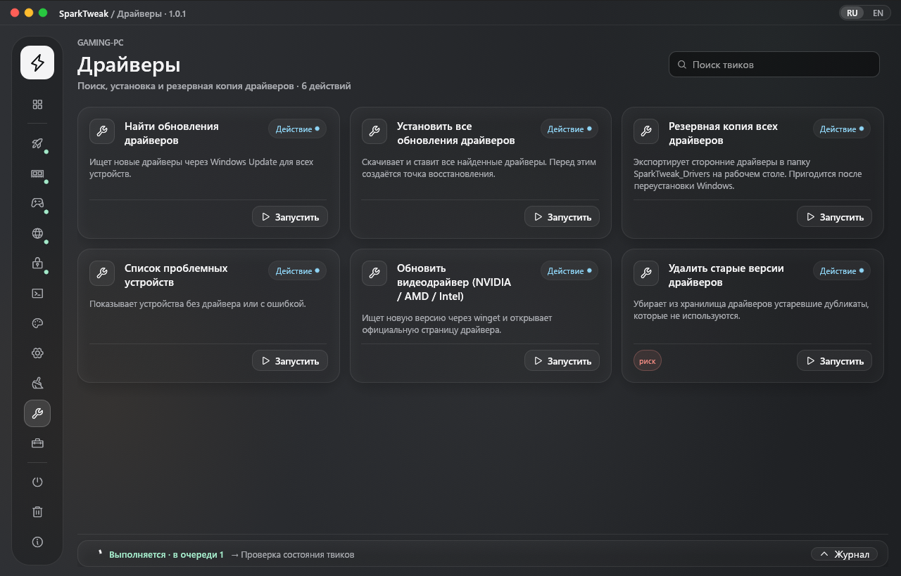
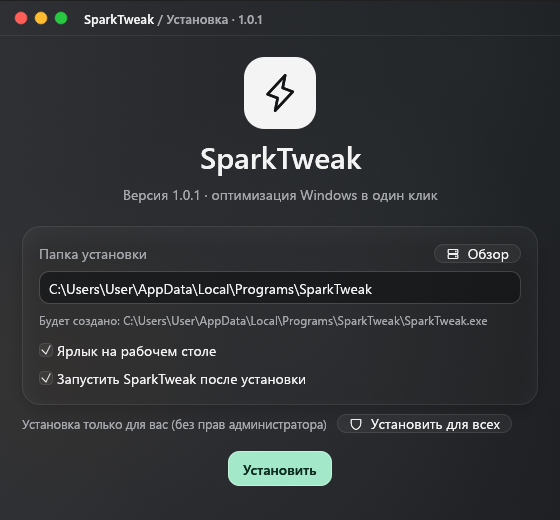
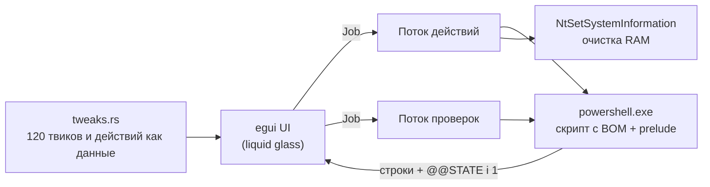
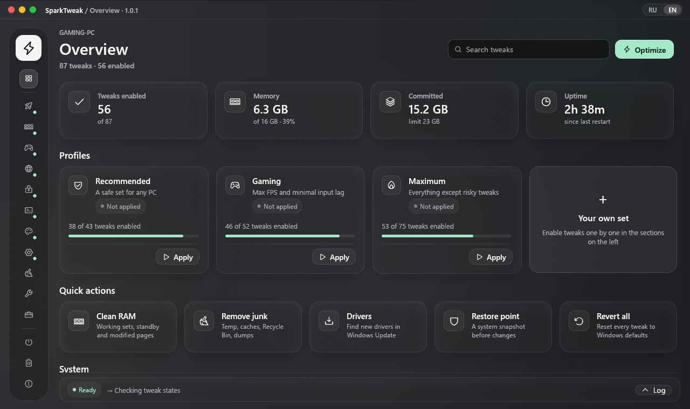

<div align="center">


# SparkTweak

**Оптимизация Windows в один клик. 87 твиков и 33 инструмента: очистка RAM, драйверы, автозагрузка и удаление мусора в одном нативном приложении на Rust.**

[](https://github.com/s0nd3r-py/SparkTweak/actions/workflows/build.yml)
[](https://github.com/s0nd3r-py/SparkTweak/releases/latest)
[](https://github.com/s0nd3r-py/SparkTweak/releases)


[](LICENSE)

[**⬇ Скачать установщик**](https://github.com/s0nd3r-py/SparkTweak/releases/latest/download/SparkTweak-Setup.exe) · [Портативная версия](https://github.com/s0nd3r-py/SparkTweak/releases/latest/download/SparkTweak-Portable.exe) · [Что внутри](#-что-умеет) · [Безопасность](#-безопасность) · [Сборка](#-сборка-из-исходников) · [🇬🇧 English](#-english)



</div>

---

## ✨ Почему SparkTweak

|  |  |
|---|---|
| ⚡ **Один клик** | Три готовых профиля: «Рекомендуемый», «Игровой», «Максимум». Перед применением автоматически создаётся точка восстановления. |
| ↺ **Всё откатывается** | У каждого твика есть кнопка «Откатить». Программа сама проверяет, что включено в системе, а не хранит догадки в конфиге. |
| 🔍 **Ничего не спрятано** | Все 120 твиков и действий — это обычные записи реестра, службы и команды Windows, описанные данными в [`tweaks.rs`](app/src/tweaks.rs). Перед применением их можно прочитать. |
| 🪶 **Лёгкий и нативный** | Один exe на Rust, без .NET, Electron и фоновых служб. Окно на GPU через egui с настоящим размытием Windows (acrylic). |
| 🧪 **Проверено тестами** | CI прогоняет каждую проверку состояния в настоящем PowerShell и разбирает каждый скрипт парсером PowerShell. Опечатка в твике не попадёт в релиз. |
| 🌍 **Русский и английский** | Переключатель RU / EN в заголовке окна. При первом запуске язык берётся из Windows. |

## 📸 Скриншоты

| Память и очистка RAM | Игры |
|---|---|
|  |  |
| **Драйверы** | **Установщик** |
|  |  |

## 🧰 Что умеет

| Раздел | Что внутри | Шт. |
|---|---|:-:|
| 🚀 **Производительность** | План Ultimate Performance, Power Throttling, приоритет активного окна, HAGS, Core Parking, NTFS, мгновенные меню, быстрое выключение | 17 |
| 🧠 **Память** | **Очистка RAM через NT API** (рабочие наборы, standby-список как в ISLC, modified list), авто-очистка по таймеру, SysMain, сжатие памяти, Edge/Chrome в фоне, виджеты, Copilot | 10 |
| 🎮 **Игры** | Приоритет MMCSS, Game DVR, FSO, ускорение мыши, глобальный таймер, dynamic tick, VBS, MSI-прерывания для GPU | 11 |
| 🌐 **Сеть** | Nagle, NetworkThrottlingIndex, QoS 20%, Cloudflare DNS, TCP autotuning/RSS/ECN, сброс сетевого стека | 8 |
| 🔒 **Приватность** | Телеметрия и DiagTrack, рекламный ID, Recall, Bing в «Пуске», реклама и предложения, задания CEIP | 12 |
| 💻 **PowerShell** | NGen-компиляция (запуск в 2–5 раз быстрее), отключение телеметрии PS/.NET, отключение PS 2.0, журнал скриптов, PowerShell 7 и PSReadLine | 9 |
| 🎨 **Интерфейс** | Классическое контекстное меню, «Завершить задачу» на панели задач, тёмная тема, секунды в часах, Explorer | 16 |
| ⚙ **Службы** | Xbox, печать, факс, биометрия, Bluetooth, Hyper-V, автоперезагрузка после обновлений | 9 |
| 🧹 **Очистка** | Temp, кэш Windows Update и Delivery Optimization, корзина, миниатюры, дампы, кэши браузеров и шейдеров, WinSxS. Показывает, сколько освобождено | 12 |
| 🔧 **Драйверы** | Поиск и установка драйверов через Windows Update, бэкап всех драйверов, проблемные устройства, удаление старых версий | 6 |
| 🛠 **Система** | Точка восстановления, бэкап реестра, SFC, DISM, TRIM, chkdsk, `winget upgrade --all`, отчёт о батарее | 10 |
| ⏻ **Автозагрузка** | Включение и отключение программ так же, как в Диспетчере задач (`StartupApproved`) | — |
| 🗑 **Удаление приложений** | 37 предустановленных Appx: Bing, Clipchamp, Teams, Solitaire, Candy Crush, TikTok… | 37 |

У каждого твика есть пометки: `рекомендуется`, `игры`, `риск`, `ребут`. Профиль «Максимум» никогда не включает твики с пометкой `риск`.

## 🏗 Как это устроено



- **Твик — это данные.** `Reg(путь, имя, вкл, выкл)` плюс необязательные `apply`/`revert`/`check` на PowerShell. Из записей реестра автоматически генерируются скрипты применения, отката и проверки.
- **Состояние читается из системы.** Каждая операция заканчивается проверкой `@@STATE`, поэтому переключатель показывает реальное положение дел.
- **Две очереди.** Проверка ~90 твиков идёт в отдельном потоке и не блокирует действия пользователя.
- **Очистка памяти без PowerShell.** Через `NtSetSystemInformation(SystemMemoryListInformation)` с привилегией `SeProfileSingleProcessPrivilege`, тем же механизмом, что у RAMMap и ISLC.
- **Установщик тоже на Rust.** `SparkTweak-Setup.exe` встраивает приложение через `include_bytes!`, создаёт ярлыки и запись в «Установленных приложениях». Удаление штатное, через Параметры Windows.

```
app/src/
├── main.rs     — запуск, UAC, удаление (--uninstall)
├── tweaks.rs   — каталог твиков + генерация PowerShell + тесты
├── sys.rs      — PowerShell-раннер, NT API памяти, права, DWM
├── style.rs    — графитовый glass-стиль, иконки Phosphor, виджеты
└── ui.rs       — страницы, сетка карточек, очереди задач
setup/src/main.rs — установщик
```

## 🛡 Безопасность

- Перед профилями и установкой драйверов **автоматически создаётся точка восстановления**.
- Любой переключатель возвращает значение Windows по умолчанию. В разделе «Система» есть **полный бэкап реестра** одной кнопкой.
- Твики с пометкой `риск` (VBS, Spooler, Bluetooth, биометрия и т. п.) никогда не включаются профилями «Рекомендуемый» и «Игровой».
- Нет телеметрии, сетевых запросов и фоновых служб. Программа работает, только пока открыта.
- Exe пока не подписан цифровой подписью, поэтому SmartScreen может показать предупреждение («Подробнее» → «Выполнить в любом случае»). Хэши SHA-256 лежат в каждом релизе.

> [!WARNING]
> Твикер меняет системные настройки. Не включайте всё подряд, если не понимаете, что делает твик: описание есть на каждой карточке.

## 🔨 Сборка из исходников

Нужны Rust (stable) и MSVC Build Tools.

```powershell
git clone https://github.com/s0nd3r-py/SparkTweak
cd SparkTweak
cargo test -p sparktweak                    # проверки и разбор всех скриптов в PowerShell
cargo build --release -p sparktweak         # target/release/sparktweak.exe
cargo build --release -p sparktweak-setup   # target/release/SparkTweak-Setup.exe (встраивает exe выше)
```

Переменные для разработки:

| Переменная | Что делает |
|---|---|
| `SPARKTWEAK_NOELEVATE=1` | не запрашивать UAC при запуске |
| `SPARKTWEAK_SOLID=1` | непрозрачный фон вместо acrylic (для скриншотов) |

### Как добавить твик

Достаточно одной записи в [`app/src/tweaks.rs`](app/src/tweaks.rs):

```rust
Tweak {
    name: "Мгновенные меню",
    desc: "Убирает задержку 400 мс перед открытием подменю.",
    cat: Perf,
    regs: &[Reg(DESK, "MenuShowDelay", S("0"), Some(S("400")))],
    rec: true,
    ..T
},
```

Применение, откат и проверка состояния сгенерируются автоматически. Тесты сами прогонят новую проверку в PowerShell.

## 🇬🇧 English

**SparkTweak is a one-click Windows 10/11 optimizer written in Rust**, with a dark liquid-glass interface in Russian and English (switch RU / EN in the title bar).



- **87 reversible tweaks and 33 tools** across Performance, Memory, Gaming, Network, Privacy, PowerShell, Interface, Services, Cleanup, Drivers and System.
- **Three one-click profiles** (Recommended, Gaming, Maximum). A restore point is created automatically first. Maximum never includes tweaks marked *risky*.
- **RAM cleaner** built on `NtSetSystemInformation`: working sets, standby list (like ISLC) and modified pages, with an optional auto-clean timer.
- **Drivers** via Windows Update: find, install, back up, list problem devices.
- **Startup manager** (same mechanism as Task Manager) and **removal of 37 preinstalled apps**.
- **Everything reverts with one click**, and each switch shows the real state read from your system.
- **Rust installer**: installs for everyone (with admin rights) or just for you in `%LOCALAPPDATA%\Programs\SparkTweak` (no admin needed). Uninstall from Settings → Apps.

[**⬇ Download the installer**](https://github.com/s0nd3r-py/SparkTweak/releases/latest/download/SparkTweak-Setup.exe) · [Portable](https://github.com/s0nd3r-py/SparkTweak/releases/latest/download/SparkTweak-Portable.exe)

The exe is not code-signed yet, so SmartScreen may warn you: *More info → Run anyway*. SHA-256 checksums ship with every release. Build from source with `cargo build --release -p sparktweak`, then `-p sparktweak-setup`.

## 📄 Лицензия

[MIT](LICENSE) © 2026 s0nd3r-py. Используйте на свой страх и риск.

<div align="center"><sub>Если SparkTweak ускорил вашу систему, поставьте ⭐: так проект увидит больше людей.</sub></div>
